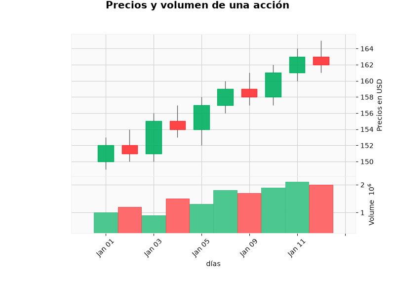
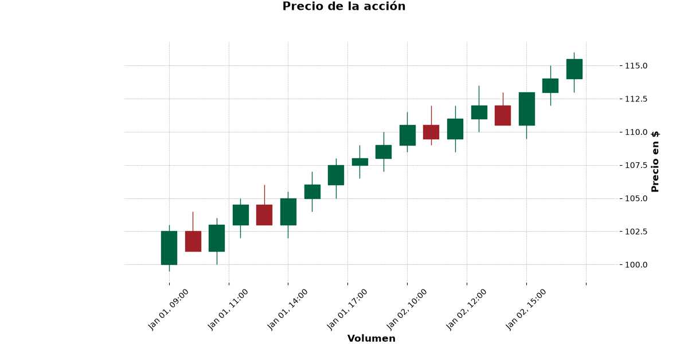

# Velas japonesas con Python

Ejercicios del curso **Big Data con Python (sector sanitario)** para dibujar gráficos de velas japonesas (*candlestick*) con [`pandas`](https://pandas.pydata.org/) y [`mplfinance`](https://github.com/matplotlib/mplfinance).

Cada vela resume el precio de un periodo con cuatro valores (OHLC):

- **Open**: precio de apertura
- **High**: precio máximo
- **Low**: precio mínimo
- **Close**: precio de cierre

Si el cierre es mayor que la apertura, la vela es alcista (verde); si es menor, es bajista (roja).

## Contenido

| Archivo | Descripción |
| --- | --- |
| [`acciones_empresa.csv`](acciones_empresa.csv) | Datos diarios OHLCV de una acción (10 días hábiles de enero de 2024). |
| [`ejercicio_VelasJaponeasaPrimeraGrafica.py`](ejercicio_VelasJaponeasaPrimeraGrafica.py) | Lee el CSV, convierte `Date` a `datetime`, lo usa como índice y dibuja velas con volumen (estilo `yahoo`). |
| [`velas_japonesas.py`](velas_japonesas.py) | Construye un DataFrame intradía (2 días, velas de 1 hora) a partir de un diccionario y dibuja las velas (estilo `charles`). |
| [`imagenes/`](imagenes/) | Gráficas generadas por los scripts. |

## Gráficas generadas

### Precios y volumen de una acción (datos del CSV)



### Precio intradía de la acción (velas de 1 hora)



## Cómo ejecutarlo

```bash
pip install -r requirements.txt
python ejercicio_VelasJaponeasaPrimeraGrafica.py
python velas_japonesas.py
```

Los scripts guardan las imágenes en la carpeta `imagenes/` mediante el parámetro `savefig` de `mpf.plot`. Si prefieres ver la gráfica en una ventana, elimina ese parámetro.

## Pasos clave

1. Leer los datos con `pd.read_csv` (o construirlos con `pd.DataFrame`).
2. Convertir la columna de fecha con `pd.to_datetime`.
3. Establecerla como índice con `set_index` — `mplfinance` necesita un `DatetimeIndex`.
4. Las columnas deben llamarse `Open`, `High`, `Low`, `Close` y, opcionalmente, `Volume`.
5. Dibujar con `mpf.plot(df, type="candle", volume=True, style=...)`.
